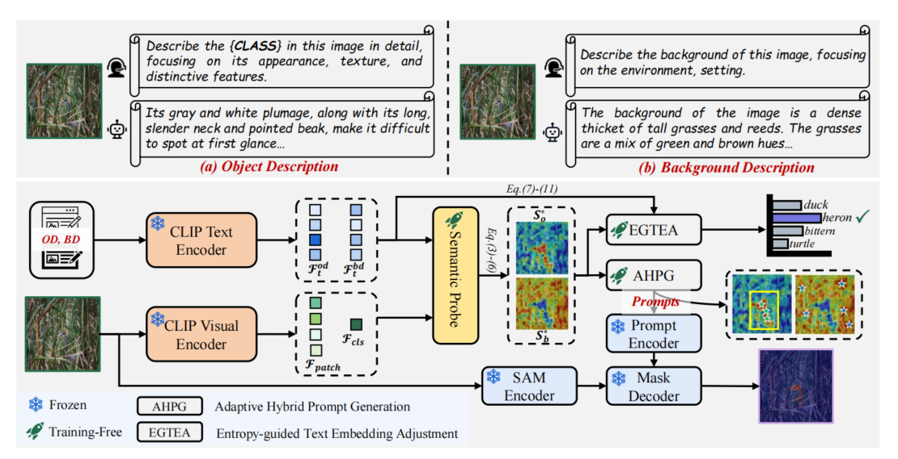

# [CVPR26]Training-Free Open-Vocabulary Camouflaged Object Segmentation via Fine-Grained Object Binding and Adaptive Hybrid Prompt

[]([#](https://github.com/ROC-Star/TFOVCOS/releases/download/paper/Camera-ready.pdf))
[](#)
 
> This is the official implementation for the **CVPR 2026** paper:  
> **Training-Free Open-Vocabulary Camouflaged Object Segmentation via Fine-Grained Object Binding and Adaptive Hybrid Prompt** 

> *Peng Ren, Cheng Jiang, Chuande Yang, Fuming Sun, Tian Bai* 

## 📝 Abstract

Vision-Language models (e.g., CLIP) facilitate the development of open-vocabulary camouflaged object segmentation (OVCOS), but existing methods still rely on mask annotations for fully-supervised training. In contrast, the training-free paradigm can rapidly process unseen data, representing a highly promising solution. However, in camouflage scenarios, existing training-free methods utilize sparse textual prompts and ignore the category similarity between visual patches, leading to inadequate object binding capability. To alleviate these issues, we propose a fine-grained object binding and adaptive hybrid prompt framework for training-free OVCOS. We employ multimodal large language models (MLLMs) to explicitly model fine-grained textual descriptions, construct a semantic probe to decouple object and background features, and propose an entropy-guided text embedding adjustment (EGTEA) strategy to enhance fine-grained object binding. Finally, an adaptive hybrid prompt generation (AHPG) strategy is utilized to assist SAM in accurately segmenting camouflaged objects.

## 🚀 Architecture


## 📊 Data Preparation

We evaluate our method on the OVCamo benchmark.


## ⚙️ Installation

The framework is implemented in PyTorch. To set up the environment, please run:

```bash
# Create a conda environment
conda create -n tfovcos python=3.10
conda activate tfovcos

# Install required packages (CLIP, SAM, LLaVA, etc.)
pip install -r requirements.txt
```


## 🏃 Usage

Download Pre-trained Models(CLIP-ViT-L/14, SAM-ViT-H)

As this is a training-free framework, you only need to run the main.py

```bash
python main.py --config ./configs/ovcoser.py --model-name TFOVCoser --evaluate
```

## 🏆 Results
Download our [results](https://github.com/ROC-Star/TFOVCOS/releases/download/model-results/pre.zip) and unzip it.

Run the script: ``` python evaluate.py --pre <path>/results ```


## 🎓 Citation

 If you find this work useful for your research, please consider citing:
 ```bash
@inproceedings{ren2026trainingfree,
  title={Training-Free Open-Vocabulary Camouflaged Object Segmentation via Fine-Grained Object Binding and Adaptive Hybrid Prompt},
  author={Ren, Peng and Jiang, Cheng and Yang, Chuande and Sun, Fuming and Bai, Tian},
  booktitle={Proceedings of the IEEE/CVF Conference on Computer Vision and Pattern Recognition (CVPR)},
  year={2026}
}
```

## 🤝 Thanks
This project is built on [OVCamo](https://github.com/lartpang/OVCamo).


